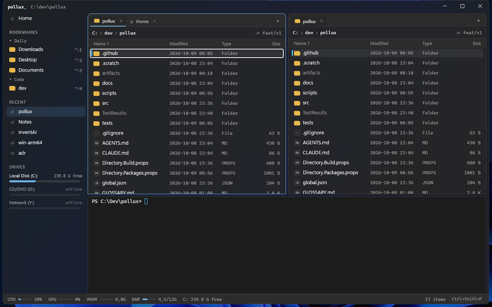

# Pollux

A fast, offline, keyboard-friendly file manager for Windows 11, built with WinUI 3, .NET and Native AOT.
It is made for developers who work in VS Code and with agentic coding tools.



- **Instant.** Pollux keeps running in the tray (optional), so a new window takes about 50 ms. A cold start takes about 400 ms.
- **Offline.** Pollux makes no network connections: no telemetry, no update pings, no cloud ([ADR 0001](docs/adr/0001-pollux-never-opens-network-connections.md)). The only exception is `winget` in the Updates view, and only if you start it.
- **No admin.** Pollux installs per user and runs without elevation. An Admin Instance is available when you need it (it asks for consent through UAC or Delinea).

## Features

| | |
|---|---|
| **Dual pane + tabs** | Two Panes, each with its own Tabs. `Ctrl+<` toggles dual pane, `Ctrl+1/2` or `Tab` switches pane, `F5`/`F6` copies or moves to the other pane. Drag tabs to reorder them, into the other pane or into another Pollux window; `Ctrl+Shift+Alt+N` moves the current tab to a new window |
| **Bookmarks** | Grouped and reorderable. `Ctrl+D` adds the current folder, `Ctrl+Shift+1…9` jumps to a bookmark |
| **Quick Search** | `Ctrl+P` does a fuzzy search over an in-memory index of your Index Roots (bookmarks, repos, Downloads, Desktop, Documents and Notes). `node_modules`, `.git`, `bin` and `obj` are skipped |
| **Filter** | `Ctrl+F` filters the current folder live by substring or word initials (`dbp` → `Directory.Build.props`) |
| **Command palette** | `Ctrl+Shift+P` runs any command. All keys can be remapped in `keybindings.json` (VS Code format) or on the Settings page |
| **Embedded terminal** | `Ctrl+ö` toggles a PowerShell, pwsh or cmd panel (ConPTY + xterm.js) that opens in the active folder. `Ctrl+Alt+T` opens Windows Terminal instead |
| **Copy & move queue** | `F5`/`F6`, paste and drag & drop all run in a Pollux queue. A progress bar in the status bar shows speed and lets you pause, resume or cancel. Conflicts ask *Replace / Keep both / Skip* (optionally for the whole job) or follow a fixed rule. Partial files are removed if you cancel. The classic Windows dialogs are still available as a setting (`files.operationEngine`) |
| **Folder Search** | `Ctrl+Shift+F` searches the current folder and its subfolders by name (`*.ext`), text content, date (`after:7d`) and size (`size>1mb`). Results stream in; `Ctrl+Enter` shows one in its folder |
| **Undo & redo** | `Ctrl+Z` / `Ctrl+Y` undo and redo renames, new files and folders, copy, move, paste, drag & drop and deletes to the Recycle Bin. Undo refuses, with the reason, when the disk changed meanwhile |
| **View modes** | Details, Tiles or Large Icons per Tab (`Ctrl+Alt+1/2/3`) with Windows thumbnails for the visible entries. Optional columns for Created, Attributes and Extension, and grouping by Type or Modified date |
| **Selection** | `Ctrl+Shift+A` selects none and `Ctrl+I` inverts the selection; select or deselect by wildcard pattern (`*.log;*.tmp`) from the command palette |
| **Batch rename** | `Ctrl+M` renames the selection with find/replace (plain or regex), case changes and numbering, e.g. `{name}_{n:000}{ext}`, with a live preview |
| **Links** | Create a shortcut (.lnk), symbolic link or junction for the selection, here or in the other Pane. Targets show as a tooltip |
| **Zip** | Compress the selection to a zip, or extract a zip to a new folder or here, in the background with a cancellable progress toast. Extraction never overwrites files |
| **Folder sizes** | `Alt+S` calculates the size of every folder in the listing, so folders can be sorted by size |
| **Compare & sync** | `Ctrl+Alt+D` marks what differs between both Panes (only left, only right, newer, older, differs). Sync copies new and newer items to the other Pane after a confirmation and never deletes |
| **Drives** | Map network drives, disconnect them, or eject removable and optical drives from the sidebar's Drives section or the command palette |
| **Recycle Bin** | Browse the Recycle Bin as a location with original name, place and date. Restore entries to where they came from, or delete them permanently or empty the bin (both ask first) |
| **Preview pane** | `Alt+P` shows the selection next to the panes: code with highlighting, images, PDFs, hex for binaries and a summary for folders. It updates while you arrow through the list |
| **Quick Look** | `Space` previews the selection: images, code with syntax highlighting (Monaco), PDFs, a hex view for binaries, and a summary for folders |
| **Notes** | Plain Markdown files edited with Monaco, so VS Code keys work, including multi-cursor. Notes are saved automatically and named after their first line. Tags come from `#tags` or front matter. `Win+Alt+N` creates a new note from anywhere |
| **Downloads Stack** | Left-click the tray icon or press `Win+Alt+D` to see your newest downloads, like a macOS Dock stack. You can drag files out of it |
| **Clipboard History** | Optional, off by default (Settings › Clipboard). Pollux records the text, images and file lists you copy, so older copies stay one keystroke away. `Win+Alt+V` opens the **Clipboard Stack** from anywhere: type to search by substring or word initials, substring matches first (`@code` narrows to Clips copied from VS Code), `Enter` pastes into the previous window, `Shift+Enter` only puts the Clip on the clipboard. **Kept Clips** stay at the top and never rotate out. Optionally `Win+V` opens it instead of Windows' own clipboard history. Copies the source app marks as private (as most password managers do) and copies from processes on your exclusion list are not recorded; there is no other password-manager detection |
| **Workspaces** | Save a window's panes, tabs, Workspace Bookmarks and terminal folder, then switch with `Ctrl+Alt+W` or `pollux --workspace NAME` |
| **Inbox** | Treat the Desktop as an Inbox: hide its icons, then sort it into `Documents\Inbox\<category>` (with a preview first) |
| **App updates** | A `winget upgrade` list where you pick which updates to install, either normally or as admin. Automatic checks are opt-in |
| **Status bar** | CPU, GPU, VRAM, RAM and free space on the current drive. It refreshes only while a window is visible |
| **Git aware** | Shows the current branch in the path bar and in Quick Look. Git status letters appear only in **Trusted Folders** (covering their subfolders; network locations cannot be trusted): click *Trust this folder* in the path bar or edit `files.trustedFolders`. Elsewhere only the branch is shown, read without running git |
| **Hand-offs** | Open in VS Code (`Ctrl+Shift+E`), open in the GitHub Copilot app (configurable command) and copy paths (plain, quoted or with `/`) |
| **Win+E** | Optional: open Pollux instead of Explorer with Win+E |

## Install

1. Download `Pollux-win-x64.zip` (or `-arm64`) from the [releases](../../releases), or build it yourself (see below).
2. Unzip it, then run this from the unzipped folder:

```powershell
powershell -ExecutionPolicy Bypass -File .\install.ps1
```

Pollux is copied to `%LocalAppData%\Programs\Pollux` and gets a Start menu shortcut. To remove it, run `uninstall.ps1` from that folder (add `-RemoveData` to also delete settings, state and the Clipboard History; notes are kept). If you turned on the `Win+V` takeover, `uninstall.ps1` also restores Windows' clipboard history setting to what it was before, even if Pollux was force-closed.

To install for all users instead (Program Files; useful where the Admin Instance is a real security boundary), run from an elevated PowerShell:

```powershell
powershell -ExecutionPolicy Bypass -File .\install.ps1 -AllUsers
```

`uninstall.ps1` removes either install.

### Verifying a download

Each release lists `SHA256SUMS` and carries build attestations. Compare `(Get-FileHash .\Pollux-win-x64.zip).Hash` with the matching line, and check the provenance with `gh attestation verify .\Pollux-win-x64.zip --repo <owner>/<repo>`. See [SECURITY.md](SECURITY.md).

## Configuration

Everything Pollux uses lives in a few readable files:

| File | Contents |
|---|---|
| `%AppData%\Pollux\settings.json` | All settings (JSONC). The Settings page (`Ctrl+,`) edits the same file, and changes apply immediately |
| `%AppData%\Pollux\keybindings.json` | `{ "key": "ctrl+n", "command": "tab.new" }`; a `-command` entry removes a default |
| `%AppData%\Pollux\bookmarks.json`, `workspaces\*.json` | Bookmarks and Workspaces |
| `%LocalAppData%\Pollux\` | Recent, session, the WebView2 profile and logs (`startup.log` has the startup timings, `errors.log` has exceptions) |
| `%LocalAppData%\Pollux\clipboard\` | Clipboard History: `history.dat` and `images\`. Encrypted with DPAPI for your Windows user, so only your account on this PC can read them. Never synced, never sent anywhere. Clear History (command palette) removes everything except Kept Clips |
| `Documents\Pollux\Notes\` | Your notes as `.md` files (the folder is configurable) |

## Command line

```text
Pollux.exe [folder|file]           open a window at a folder, or with the file selected
Pollux.exe --workspace "Name"      open a Workspace
Pollux.exe --command id[,id…]      run commands in the frontmost window (e.g. view.toggleDual)
Pollux.exe --notes | --downloads   open a new note / the Downloads Stack
Pollux.exe --clipboard             open the Clipboard Stack
Pollux.exe --background            start in the tray only (used for autostart)
Pollux.exe --quit                  stop the background process
```

## Security

See [SECURITY.md](SECURITY.md) for the security model (network, privileges, stored data), the latest security review with open findings, and recommendations for use on a corporate machine.

## Build

Requirements: Windows 11, the .NET 10 SDK and Visual Studio 2026 with the *WinUI application development* and *Desktop development with C++* workloads (Native AOT links with the C++ toolchain).

```powershell
dotnet test --project tests/Pollux.Core.Tests
dotnet publish src/Pollux.App -c Release -p:Platform=x64 -r win-x64 -o artifacts/win-x64
```

`Pollux.Core` has no Windows dependency, so its tests also run on macOS and Linux. Pushing a tag `v*` builds release zips for x64 and ARM64.

Domain language: [GLOSSARY.md](GLOSSARY.md). Decisions: [docs/adr](docs/adr).

## Third-party code

| Component | License | Used for |
|---|---|---|
| Windows App SDK (WinUI 3, WebView2) | MIT / Microsoft | UI |
| [Monaco Editor](https://github.com/microsoft/monaco-editor) 0.57.0 | MIT | Notes editor, code preview (bundled in `Assets/web/monaco`, loaded from disk only) |
| [xterm.js](https://github.com/xtermjs/xterm.js) 6.0.0 + addon-fit | MIT | Embedded terminal (bundled in `Assets/web/xterm`) |

## License

Pollux is released under the [MIT License](LICENSE). Bundled third-party code keeps its own license (see above).
